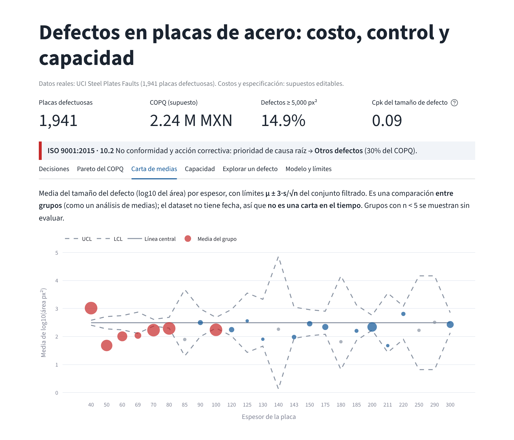

# Manufacturing intelligence: steel-plate defects

*English · [Español](README.es.md)*

> **This project now lives in [steel-plates-quality-mlops](https://github.com/jesusgonzalezmexdata-ux/steel-plates-quality-mlops)**, which contains this Power BI and Streamlit layer (`qbi/`, `powerbi/`, `etl/`) together with the model, its evidence and the human-review triage MVP. This repository is kept read-only for reference; new work goes there.

**A decision system for quality: which defects to contain, which ones need root-cause analysis, and how reliable each conclusion is.**

Power BI (DAX, Power Query M) · Python (pandas) · SQL (DuckDB) · Streamlit · statistical process control · COPQ · ISO 9001

> **Real data, with clear limits.** Uses UCI's *Steel Plates Faults*: 1,941 plates, **all defective**. It has no good plates, dates, machines, shifts or costs. Therefore the COPQ uses **assumed**, editable costs, the control chart compares **groups** (it is not a chart over time) and the defect-size specification limit is **assumed**. None of that was invented on top of the data: it is labelled where it appears.

## The decision it supports

A quality manager with a limited budget needs to know where to act first. The dashboard turns the data into a rule with thresholds and cites the ISO 9001:2015 clause behind each action:

| Signal | Threshold (management assumption) | Action | ISO 9001:2015 |
|---|---|---|---|
| ≥ 10 % of plates with a defect larger than 500 px² | `UMBRAL_FUERA_USL_PCT` | Contain: segregate and inspect 100 % | 8.7 Control of nonconforming outputs |
| One type accounts for ≥ 20 % of COPQ | `UMBRAL_COPQ_PCT` | Root-cause analysis and corrective action | 10.2 Nonconformity and corrective action |
| Cpk < 1.00 with no other signal | Reference, not a sole criterion | Monitor and evaluate | 9.1.3 Analysis and evaluation |

Thresholds live in `qbi/config.py` and in `powerbi/dax/measures.dax` (`Accion Recomendada`).


## Executive summary

**With illustrative costs, defects add up to MXN 2.24 million. Three types concentrate 78 % of the cost, and the K-scratch is the most damaging: 20 % of plates, but 267 of the 289 large defects (≥ 5,000 px²).**

| Finding | Evidence |
|---|---|
| Cost concentrates in few types | Other faults, K-scratch and bumps add up to 77.7 % of the assumed COPQ |
| The K-scratch is the large defect | Median area 6,281 px² against 16–209 px² for the others; 92 % of defects ≥ 5,000 px² |
| It is confined to one steel and one thickness | 99.7 % in A400 steel and 99 % in thickness 40 |
| Thickness 40 carries 42 % of COPQ | 710 of 1,941 plates |
| Only stains are within thresholds | 0 % of plates exceed 500 px²; all other types trigger containment, root cause or both |



## How reliable each conclusion is

Details and code in [`docs/pruebas_de_estres.md`](docs/pruebas_de_estres.md) (Spanish).

| Conclusion | Test | Result |
|---|---|---|
| Three types concentrate the cost | Costs varied ±30 % at random, 2,000 times | The same trio stays on top in 99 % of cases |
| The K-scratch is number one in cost | Same simulation | **Does not hold**: it leads in 27 %. The trio is claimed, not the first place |
| The process is not capable | Specification limit from 200 to 5,000 px² | Overall Cpk between −0.08 and 0.51: always below 1.00 |
| Cpk is valid | Shapiro-Wilk by type | **No**: no distribution is normal. The decision uses the empirical share above the limit |
| Thickness explains the out-of-limit groups | Same chart without K-scratch, and bumps only | From 7 of 19 down to 4 of 19 and to 1 of 9: much of it is the defect type |

## Traceability between data, measure and standard

| Data / measure | DAX measure | Clause |
|---|---|---|
| Plates with a defect above the limit | `% Fuera de USL` | 8.7 |
| Cost by type and Pareto | `COPQ MXN`, `COPQ Acumulado %` | 10.2, 9.1.3 |
| Control limits by group | `UCL`, `LCL`, `Fuera de Limites` | 9.1.1 Monitoring and measurement |
| Capability | `Cpk`, `Semaforo Cpk Color` | 9.1.1 (reference) |
| Decision rule | `Accion Recomendada`, `Texto ISO 10.2` | 8.7, 10.2 |

## Contents

| Deliverable | Where |
|---|---|
| Star schema (1 fact, 3 dimensions) | `data/model/`, diagram in `docs/diccionario_de_datos.md` |
| Reproducible ETL | `etl/build_star_schema.py` |
| Power Query M queries (unpivot, merges, conditional columns) | `powerbi/powerquery/` |
| DAX measures | `powerbi/dax/measures.dax` |
| Power BI theme | `powerbi/theme.json` |
| Equivalent Streamlit dashboard | `streamlit_app.py` |
| Data dictionary and terminology mapping | `docs/diccionario_de_datos.md` |
| Stress tests and corrected errors | `docs/pruebas_de_estres.md` |
| Guide to build the .pbix on Windows | `docs/construir_en_power_bi.md` |
| 16 automated tests | `tests/` |

Measure and file names are in Spanish, as in the original deliverable.

## Method

1. **Data.** The public CSV becomes a star schema. Each plate has a single defect type (verified); the seven indicator columns become a dimension.
2. **COPQ.** Cost per affected plate by defect type, from an editable table. Pareto by cost with cumulative percentage.
3. **Means chart by thickness.** Mean of log10 area with limits **μ ± 3·s/√n**. It is a comparison between groups. The file is sorted by defect type, so `id` is not a sequence and a chart over time would be an artefact.
4. **Capability.** Upper one-sided Cpk of defect size (log10), with a traffic light: green ≥ 1.33, amber ≥ 1.00, red below. Reference only: normality does not hold.
5. **Cross-validation of measures.** Each measure exists in three forms: DAX, Python and SQL on DuckDB. Tests require Python and SQL to agree.

## How to run it

```bash
python -m venv .venv
.venv\Scripts\activate            # Windows · macOS/Linux: source .venv/bin/activate
pip install -r requirements-dev.txt

python -m etl.build_star_schema    # regenerate data/model/
python -m tools.stress_tests       # regenerate docs/pruebas_de_estres.md
pytest                             # 16 tests
streamlit run streamlit_app.py
```

For the Power BI dashboard, follow `docs/construir_en_power_bi.md` (Spanish).

## Power BI

- Versioned PBIP project in [`powerbi/project/`](powerbi/project/).
- Executable PBIX artifact in [`powerbi/artifacts/`](powerbi/artifacts/): [`steel-plates-quality-bi.pbix`](powerbi/artifacts/steel-plates-quality-bi.pbix).
- The PBIX is managed with Git LFS. To download its bytes after cloning: `git lfs pull`.

```text
POWER BI ARTIFACTS: AVAILABLE
POWER BI VALIDATION: PENDING
```

The PBIP parameter `RutaCSV` points to the public URL of the CSV in this repository, so the project refreshes on any machine with a connection. To work offline, change it in Power BI Desktop to the local path of `data/raw/steel_plates_faults.csv`.

## Limitations

- **Power BI Desktop validation pending.** The PBIP and PBIX artifacts are available. Running and checking gates G1–G5 of [`docs/construir_en_power_bi.md`](docs/construir_en_power_bi.md) still lacks evidence; having the files does not prove the analytical validation.
- **No time, machine or shift.** No control chart over time and no scrap %. `measures.dax` keeps a commented moving-range pattern for when dates exist.
- **Thickness and defect type are confounded.** 99 % of K-scratches fall in thickness 40.
- **Assumed costs, specification limit and action thresholds.** Replace them with your plant's; the Pareto order depends on them.
- **Defect families** (Surface, Shape, Other): the analyst's grouping.

The machine-learning classifier built on the same dataset is in [steel-plates-quality-mlops](https://github.com/jesusgonzalezmexdata-ux/steel-plates-quality-mlops).

---

**Jesús R. L. González** · Data Analyst and Data Scientist · Manufacturing operations and quality · [LinkedIn](https://www.linkedin.com/in/jesus-r-l-gonzalez)

Code under [MIT](LICENSE). *Data: Steel Plates Faults, UCI Machine Learning Repository (Semeion). Check its licence and citation on the dataset page.*
